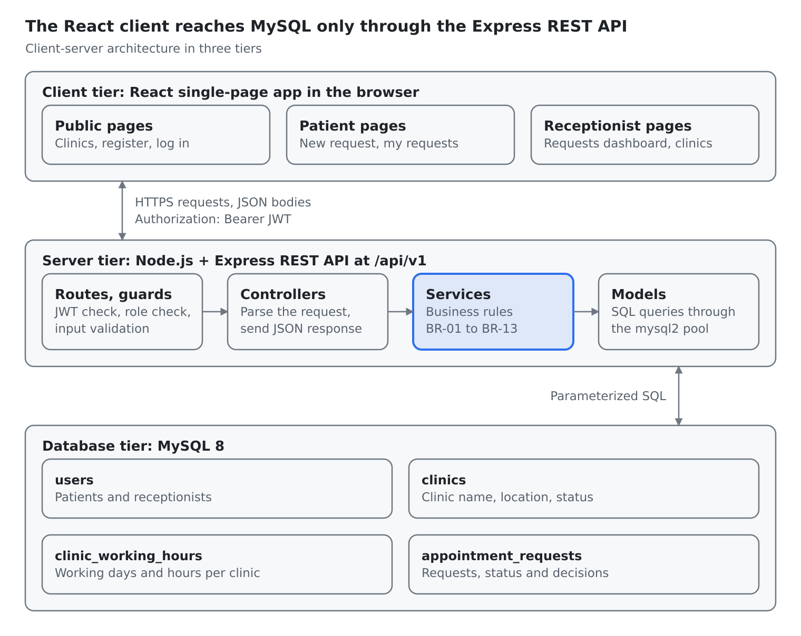

# Al-Ahli Hospital – Online Appointment Booking

Software Engineering course project (Track B – Web Application).
A website where patients of Al-Ahli Hospital in Hebron request outpatient appointments online and follow
their status, and receptionists confirm or reject the requests from a dashboard. It adds an online
channel next to the existing phone booking and is not connected to the hospital's other systems.

| | |
| --- | --- |
| Team leader | Mohammad Mujahed (231095) |
| Members | Islam Jaradat (231035), Raneem Masalmeh (221162), Murad Atawneh |
| Jira board | [AHL backlog](https://ppu-team5.atlassian.net/jira/software/projects/AHL/boards/35/backlog) |
| Requirements | SRS (Phase 2), plus `docs/` in this repository |

## Architecture

Three-tier client–server: **React** website → **Node.js / Express** REST API (`/api/v1`) → **MySQL 8**.
The browser never talks to the database; all business rules run in `backend/src/services`.



## Repository structure

```text
backend/      Express API: config, routes, middleware, controllers, services, models, tests
frontend/     React + Vite website in Arabic (right-to-left)
database/     schema.sql (tables and constraints) and seed.sql (sample clinics and users)
docs/         API endpoint list, diagrams (use case, ERD, architecture, status), Jira backlog CSV
```

## Getting started

Requirements: Node.js 22 or newer, MySQL 8.

```bash
# 1. Database
mysql -u root -p < database/schema.sql
mysql -u root -p --default-character-set=utf8mb4 < database/seed.sql

# 2. API (http://localhost:5000/api/v1/health)
cd backend
cp .env.example .env        # then set DB_PASSWORD and JWT_SECRET
npm install
npm run dev
npm test                    # skeleton tests

# 3. Website (http://localhost:5173)
cd ../frontend
npm install
npm run dev
```

Seed logins (development only, change before any real use):

| Role | Mobile | Password |
| --- | --- | --- |
| Receptionist | 0590000001 | Reception@2026 |
| Patient | 0599000001 | Patient@2026 |

## Current status

Sprint 1 (requirements, design, setup) is done: every page and API endpoint exists as a placeholder.
Endpoints answer `501 NOT_IMPLEMENTED` until their user story is built in Sprints 2–4; protected
endpoints already answer `401` without a token. See [docs/api-endpoints.md](docs/api-endpoints.md).

## How we work

- Every change starts from a Jira ticket. Branch name: `feature/AHL-<key>-<short-name>`, e.g. `feature/AHL-16-submit-request`.
- Commit messages start with the ticket key, e.g. `AHL-16: validate preferred date against clinic hours`.
- `main` must always run. Merge only through a pull request reviewed by another team member.
- Never commit `.env` files or passwords.
